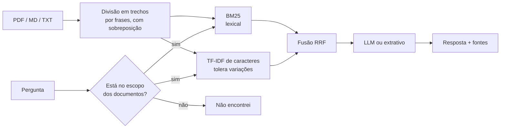

# Assistente de Documentos com RAG (em português)

[](https://github.com/juliamunizcarvalh0/assistente-rag-documentos/actions/workflows/ci.yml)


Assistente que responde perguntas sobre seus documentos (PDF, Markdown, TXT) **citando as fontes**, construído com *Retrieval-Augmented Generation*. O diferencial deste projeto é a **avaliação**: um conjunto de 43 perguntas com resposta conhecida mede objetivamente a qualidade da busca, e o CI falha se uma mudança piorar os resultados.

Funciona de dois jeitos:
- **Com LLM:** com uma chave da API da Anthropic, o Claude escreve a resposta a partir dos trechos encontrados, com citações `[1]`, `[2]`.
- **Sem chave e sem custo:** um gerador extrativo devolve as frases mais relevantes dos documentos. Qualquer pessoa consegue clonar e rodar.

## Como funciona



1. **Ingestão:** lê os documentos, mantém o número da página e o título da seção (detectado também em PDFs), e divide o texto em trechos de ~90 palavras sem cortar frases ao meio.
2. **Busca híbrida:** um BM25 implementado do zero (com stemming leve em português) e um TF-IDF de n-gramas de caracteres, combinados por *Reciprocal Rank Fusion*.
3. **Recusa:** se a pergunta usa termos que não existem nos documentos, o assistente responde que não encontrou, antes de chamar o LLM. Isso reduz alucinações e custo.
4. **Geração:** o prompt exige respostas apenas com base nos trechos e com citação de cada afirmação.

## Resultados da avaliação

Conjunto de 43 perguntas sobre três documentos de uma empresa fictícia, várias escritas com palavras diferentes das do texto (ex.: "Posso usar o wi-fi da cafeteria?" para um trecho sobre "redes Wi-Fi públicas"). Relatório completo em [`reports/avaliacao.md`](reports/avaliacao.md).

| Estratégia de busca | Hit@1 | Hit@3 | MRR |
|---|---|---|---|
| BM25 | 95% | 100% | 0,973 |
| TF-IDF de caracteres | 95% | 98% | 0,965 |
| **Híbrida (RRF)** | **98%** | **98%** | **0,983** |

| Comportamento | Resultado |
|---|---|
| Respondeu perguntas dentro do escopo | 98% |
| Recusou perguntas fora do escopo | 88% (7 de 8) |
| Resposta extrativa contém a informação esperada | 93% |

**O que aprendi com os experimentos**

- Um **stemmer simples** fez mais diferença do que trocar de algoritmo: unificar "aceitar"/"aceitos" e "fornecedor"/"fornecedores" levou o BM25 de 91% para 93% de Hit@1 e a taxa de resposta de 88% para 98%.
- **Estrutura do documento importa.** PDFs não marcam títulos; detectar as linhas de título e usá-las como seção (como no Markdown) levou a busca híbrida de 95% para 98% de Hit@1.
- **Trechos muito curtos pioram a busca** (Hit@1 entre 88% e 93% com 40 a 60 palavras, contra 98% com 90), porque perdem o contexto. Trechos maiores ajudam pouco e deixam o prompt mais caro.
- A pergunta que ainda escapa da recusa ("Quantos funcionários a empresa tem?") usa palavras genéricas que aparecem nos documentos. Um próximo passo é recusar também com base na pontuação da busca.

**Limitações honestas:** o corpus é pequeno (30 trechos), então as métricas ficam perto do teto, e o conjunto de avaliação foi usado durante o desenvolvimento. Para medir generalização, o ideal é um conjunto separado e documentos maiores.

## Como rodar

```bash
git clone https://github.com/juliamunizcarvalh0/assistente-rag-documentos.git
cd assistente-rag-documentos
python -m venv .venv && source .venv/bin/activate
make install
make app     # interface de chat em http://localhost:8501
make eval    # roda a avaliação e atualiza reports/
make test
```

Pela linha de comando:

```bash
PYTHONPATH=src python -m rag.cli "Qual o limite do Pix à noite?"
```
```
O limite padrão do Pix é de R$ 5.000 por transação durante o dia (das 6h às 20h) e de R$ 1.000 no período noturno (das 20h às 6h). [1]

  [1] guia_conta_digital.pdf (p. 1, Limites do Pix)
  ...
```

Para usar o LLM, defina `ANTHROPIC_API_KEY` (veja `.env.example`) ou cole a chave na barra lateral do app. Para usar seus próprios documentos, envie-os pela interface ou rode `python -m rag.cli --docs sua_pasta`.

## Estrutura

```
├── src/rag/
│   ├── text.py         # normalização, stopwords e stemmer em português
│   ├── ingest.py       # leitura de PDF/MD/TXT e divisão em trechos
│   ├── retrievers.py   # BM25, TF-IDF de caracteres e busca híbrida (RRF)
│   ├── generate.py     # prompt, gerador com Claude e gerador extrativo
│   ├── assistant.py    # orquestração e recusa fora do escopo
│   ├── evaluate.py     # métricas de busca, tamanho de trecho e recusa
│   └── cli.py
├── app.py              # chat em Streamlit
├── docs_exemplo/       # documentos fictícios usados no exemplo
├── eval/               # perguntas com resposta conhecida e fora do escopo
├── reports/            # relatório de avaliação gerado
└── tests/              # 16 testes, incluindo o piso de qualidade da busca
```

## Tecnologias

Python · scikit-learn · pypdf · API da Anthropic (Claude) · Streamlit · pytest · GitHub Actions

## Licença

MIT. Os documentos em `docs_exemplo/` são fictícios e foram escritos para este projeto.
