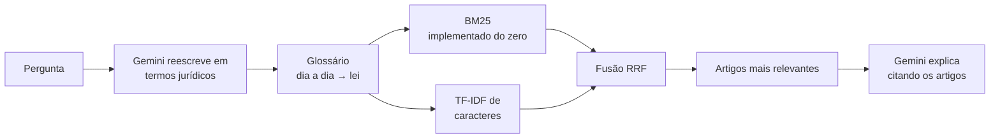

# ⚖️ Pergunte à Lei: RAG sobre leis brasileiras

[](https://github.com/juliamunizcarvalh0/assistente-rag-documentos/actions/workflows/ci.yml)


**[▶ Testar ao vivo](https://assistente-rag-documentos.streamlit.app/)**: sem instalar nada.

Assistente que responde dúvidas do dia a dia sobre o **Código de Defesa do Consumidor**, a **LGPD** e a **CLT**, em português simples e **citando o artigo exato** da lei. Construído com *Retrieval-Augmented Generation* (RAG) sobre os textos oficiais do Planalto, com 1.201 artigos indexados.

> Exemplo do tipo de resposta: "Posso desistir de uma compra que fiz pela internet?"
> **Sim. Você pode desistir em até 7 dias** a contar do recebimento do produto, segundo o art. 49 do CDC [1]...

## Como funciona



1. **Leitura das leis:** um parser próprio lê o HTML oficial do Planalto e gera um trecho por artigo, com o capítulo e a seção como contexto.
2. **Entender a pergunta:** o Gemini reescreve "apagar meus dados" como "eliminação de dados pessoais, direitos do titular", e um glossário próprio cobre os casos comuns sem custo.
3. **Busca híbrida:** BM25 (lexical, com stemming leve em português) + TF-IDF de n-gramas de caracteres, combinados por *Reciprocal Rank Fusion*.
4. **Resposta:** o Gemini responde **só com base nos artigos encontrados**, citando cada um. Se a informação não está lá, ele diz que não encontrou.
5. **Sem cota, sem quebra:** se o limite gratuito do Gemini acabar, o app volta automaticamente para o modo extrativo e mostra os trechos da lei.

## O desafio dos dados reais

O texto "compilado" do Planalto mostra **todas as versões da lei ao mesmo tempo**. Indexá-lo direto faria o assistente responder com regras revogadas. O parser trata:

- **Texto revogado:** aparece riscado, às vezes com `<strike>`, às vezes por CSS (`text-decoration: line-through`). Os dois são removidos.
- **Notas de alteração** como "(Redação dada pela Lei nº 13.467, de 2017)", inclusive quando a própria página esquece de fechar o parêntese.
- **Artigos vetados ou revogados**, que são descartados.
- **A estrutura da CLT:** o decreto de 1943 tem 2 artigos próprios e é assinado, e só então vem a Consolidação, recomeçando do art. 1. Há ainda quadros anexos em tabelas.
- **Numeração irregular:** "Art. 4º-A", "Art. 401A.", "Art. 401 - A.", "Art. 5 7." (número partido em duas tags HTML), sem confundir com "Art. 1º - Esta Consolidação…".
- **Codificação Windows-1252**, usada pelas páginas do Planalto.

Cada um desses casos tem teste automatizado em `tests/test_laws.py`.

## Avaliação

São 60 perguntas escritas como uma pessoa comum perguntaria, cada uma com o artigo e o trecho exato que a responde, divididas em dois conjuntos:

- **Desenvolvimento** (36 perguntas): usado para analisar os erros e melhorar a busca.
- **Teste** (24 perguntas, outros assuntos): **não** é usado para ajustar nada e mede se as melhorias generalizam.

Acerto do artigo certo entre os 3 primeiros resultados (Hit@3) e MRR:

| Estratégia | Hit@3 desenv. | Hit@3 teste | MRR teste |
|---|---|---|---|
| BM25 | 44% | 33% | 0,271 |
| TF-IDF de caracteres | 39% | 29% | 0,240 |
| Híbrida (RRF) | 50% | 38% | 0,306 |
| Híbrida + glossário | 81% | 42% | 0,312 |
| **Gemini reescreve a pergunta + híbrida** | 81% | **67%** | **0,526** |

A linha do Gemini vem do workflow manual [`avaliacao-gemini.yml`](.github/workflows/avaliacao-gemini.yml), em que 60 de 60 reescritas funcionaram. As demais linhas vêm de [`reports/avaliacao.md`](reports/avaliacao.md), que traz os erros pergunta por pergunta.

**O que os números mostram**

- **O problema central é o vocabulário.** As pessoas dizem "apagar meus dados", "patrão" e "almoço"; a lei diz "eliminação", "empregador" e "repouso ou alimentação". A busca por palavras não encontra o artigo certo sem ajuda.
- **Um glossário feito à mão não generaliza.** Ele levou o conjunto de desenvolvimento de 50% para 81%, mas o de teste só de 38% para 42%. O ganho grande vinha de ter sido ajustado às próprias perguntas. Numa primeira versão, algumas entradas foram inspiradas sem querer nas perguntas de teste e inflaram o resultado para 79%. Removi essas entradas e reportei o número limpo.
- **Um LLM entendendo o significado resolve o que o glossário não resolve:** nas perguntas novas, a reescrita pelo Gemini levou o acerto de 42% para **67%**, e o MRR quase dobrou (0,312 → 0,526). Isso justifica a chamada extra ao LLM antes da busca.
- **Medir também exige cuidado:** na primeira rodada, o limite por minuto do plano gratuito fez a maior parte das reescritas falhar em silêncio, e o resultado com Gemini saiu igual ao sem IA. Agora a avaliação espaça as chamadas, tenta de novo quando bate o limite e informa quantas reescritas funcionaram.
- **Sem IA, recusar perguntas fora do assunto é difícil:** só 2 de 6 foram recusadas. "Qual é a capital da Austrália?" tem uma pontuação de busca parecida com a de perguntas reais. Com o Gemini, quem recusa é o modelo, porque a resposta tem de vir dos artigos.

## Como rodar

```bash
git clone https://github.com/juliamunizcarvalh0/assistente-rag-documentos.git
cd assistente-rag-documentos
python -m venv .venv && source .venv/bin/activate
make install
make app     # interface de chat em http://localhost:8501
make eval    # avaliação da busca, atualiza reports/
make test
```

Sem chave, o app funciona no modo extrativo. Para respostas escritas pela IA, crie uma chave gratuita em [aistudio.google.com](https://aistudio.google.com) e defina `GEMINI_API_KEY` (veja `.env.example`). No Streamlit Cloud, coloque a chave em *Settings → Secrets*.

Pela linha de comando:

```bash
PYTHONPATH=src python -m rag.cli "Posso desistir de uma compra feita pela internet?"
```

## Estrutura

```
├── leis/               # HTML oficial do Planalto (CDC, LGPD, CLT)
├── src/rag/
│   ├── laws.py         # parser das leis: artigos, revogações, notas, estrutura
│   ├── ingest.py       # trechos (um por artigo) e suporte a PDF/Markdown
│   ├── text.py         # normalização, stopwords e stemmer em português
│   ├── glossary.py     # glossário dia a dia → termos da lei
│   ├── retrievers.py   # BM25, TF-IDF de caracteres, fusão RRF
│   ├── generate.py     # Gemini (resposta e reescrita) e modo extrativo
│   ├── assistant.py    # orquestração, filtro por lei e plano B sem cota
│   ├── evaluate.py     # métricas de busca nos dois conjuntos
│   └── cli.py
├── app.py              # chat em Streamlit
├── eval/               # perguntas de desenvolvimento, de teste e fora do escopo
├── reports/            # relatório de avaliação gerado
└── tests/              # testes do parser, da busca, da IA (sem rede) e piso de qualidade
```

## Limitações

- O índice reflete as leis na data do download (outubro de 2026). Para atualizar, basta substituir os arquivos em `leis/`.
- A busca ainda não usa embeddings semânticos, porque o plano gratuito do Streamlit não comporta um modelo local. Esse é o próximo passo natural para melhorar a busca sem depender da reescrita.
- O plano gratuito do Gemini pode usar as perguntas para melhorar os produtos do Google. Por isso o app pede para não incluir dados pessoais.

## Aviso

Projeto educativo. As respostas não substituem a orientação de um advogado. Os textos legais são públicos (Lei 9.610/98, art. 8º, IV) e vêm do site oficial do Planalto.

## Tecnologias

Python · Gemini API · scikit-learn · BeautifulSoup · Streamlit · pytest · GitHub Actions

## Licença

MIT
